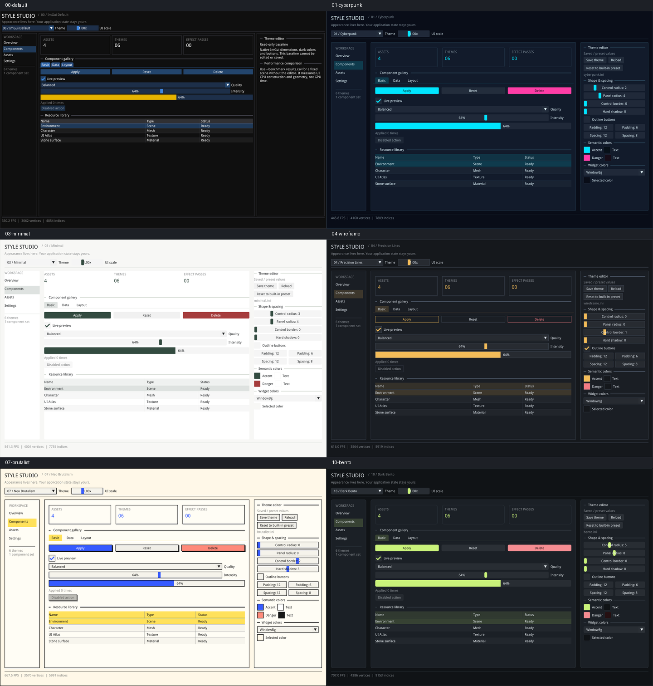

Dear ImGui
=====

<center><b><i>"给某人一个状态，他总有一天会遇到 bug；但教他如何在两个必须保持同步的分离位置表示状态，他这辈子都会遇到 bug。"</i></b></center> <a href="https://twitter.com/rygorous/status/1507178315886444544">-ryg</a>

----

[](https://github.com/ocornut/imgui/actions?workflow=build) [](https://github.com/ocornut/imgui/actions?workflow=static-analysis) [](https://github.com/ocornut/imgui_test_engine/actions?workflow=tests)

<sub>（本库基于自由且宽松的许可证提供，但需要资金支持以维持其持续改进。除了维护和稳定性之外，还有许多值得期待的功能尚未加入。如果你的公司正在使用 Dear ImGui，欢迎与我们联系。）</sub>

企业：可通过开具发票的赞助/支持合同来支持持续的开发与维护：
<br>&nbsp;&nbsp;_E-mail: contact @ dearimgui dot com_
<br>个人：在[此处](https://www.paypal.com/cgi-bin/webscr?cmd=_s-xclick&hosted_button_id=WGHNC6MBFLZ2S)支持持续的开发与维护。另请参阅 [Funding](https://github.com/ocornut/imgui/wiki/Funding) 页面。

| [简介](#the-pitch) - [用法](#usage) - [主题与样式](#themes--styles) - [工作原理](#how-it-works) - [版本发布与更新日志](#releases--changelogs) - [演示](#demo) - [入门与集成](#getting-started--integration) |
:----------------------------------------------------------: |
| [画廊](#gallery) - [支持、常见问题](#support-frequently-asked-questions-faq) -  [如何提供帮助](#how-to-help) - **[资金支持与赞助者](https://github.com/ocornut/imgui/wiki/Funding)** - [鸣谢](#credits) - [许可证](#license) |
| [Wiki](https://github.com/ocornut/imgui/wiki) - [扩展](https://github.com/ocornut/imgui/wiki/Useful-Extensions) - [语言绑定与框架后端](https://github.com/ocornut/imgui/wiki/Bindings) - [使用 Dear ImGui 的软件](https://github.com/ocornut/imgui/wiki/Software-using-dear-imgui) - [用户评价](https://github.com/ocornut/imgui/wiki/Quotes) |

### <a id="the-pitch"></a>简介

Dear ImGui 是一个**无冗余的 C++ 图形用户界面库**。它输出经过优化的顶点缓冲，你可以在启用 3D 管线的应用中随时渲染它们。它快速、可移植、与渲染器无关，并且自成一体（无外部依赖）。

Dear ImGui 的设计目标是**支持快速迭代**，并**赋能程序员**创建**内容创作工具和可视化 / 调试工具**（而不是面向普通最终用户的 UI）。为此它侧重简单和高效，因而缺少一些更高层库中常见的功能。除其他方面外，它不支持完整的国际化（从右到左文本、双向文本、文本整形等）和无障碍功能。

Dear ImGui 特别适合集成到游戏引擎（用于工具链）、实时 3D 应用、全屏应用、嵌入式应用，或任何运行在操作系统功能非标准的主机平台上的应用。

 - 最小化状态同步。
 - 最小化用户侧的 UI 相关状态存储。
 - 最小化设置和维护工作。
 - 易于创建反映动态数据集的动态 UI。
 - 易于创建代码驱动和数据驱动的工具。
 - 易于创建临时性的短生命周期工具，以及长期存在、更复杂的工具。
 - 易于修改和改进。
 - 可移植，最小化依赖，可在目标平台（主机、手机等）上运行。
 - 高效的运行时和内存占用。
 - 经过实战检验，被[游戏行业的众多主要参与者](https://github.com/ocornut/imgui/wiki/Software-using-dear-imgui)使用。

### <a id="usage"></a>用法

**Dear ImGui 的核心包含在少数几个与平台无关的文件中**，你可以轻松地在自己的应用/引擎中编译它们。它们就是仓库根文件夹中的所有文件（`imgui*.cpp`、`imgui*.h`）。**不需要特定的构建流程**：你可以把所有文件直接加入现有项目。

**适用于各种图形 API 和渲染平台的后端**位于 [backends/](https://github.com/ocornut/imgui/tree/master/backends) 文件夹中，示例应用位于 [examples/](https://github.com/ocornut/imgui/tree/master/examples) 文件夹中。你也可以创建自己的后端。只要你能渲染带纹理的三角形，就能渲染 Dear ImGui。

希望使用 C++20 模块的用户可以使用第三方扩展 [stripe2933/imgui-module](https://github.com/stripe2933/imgui-module)。

更多细节请参阅本文档的[入门与集成](#getting-started--integration)章节。

在你的应用中完成 Dear ImGui 的设置后，你可以在程序循环中的\_任意位置\_使用它：
```cpp
ImGui::Text("Hello, world %d", 123);
if (ImGui::Button("Save"))
    MySaveFunction();
ImGui::InputText("string", buf, IM_COUNTOF(buf));
ImGui::SliderFloat("float", &f, 0.0f, 1.0f);
```


```cpp
// 创建一个名为 "My First Tool" 的窗口，并带有菜单栏。
ImGui::Begin("My First Tool", &my_tool_active, ImGuiWindowFlags_MenuBar);
if (ImGui::BeginMenuBar())
{
    if (ImGui::BeginMenu("File"))
    {
        if (ImGui::MenuItem("Open..", "Ctrl+O")) { /* 做一些事情 */ }
        if (ImGui::MenuItem("Save", "Ctrl+S"))   { /* 做一些事情 */ }
        if (ImGui::MenuItem("Close", "Ctrl+W"))  { my_tool_active = false; }
        ImGui::EndMenu();
    }
    ImGui::EndMenuBar();
}

// 编辑以 4 个浮点数存储的颜色
ImGui::ColorEdit4("Color", my_color);

// 生成样本并绘制它们
float samples[100];
for (int n = 0; n < 100; n++)
    samples[n] = sinf(n * 0.2f + ImGui::GetTime() * 1.5f);
ImGui::PlotLines("Samples", samples, 100);

// 在滚动区域中显示内容
ImGui::TextColored(ImVec4(1,1,0,1), "Important Stuff");
ImGui::BeginChild("Scrolling");
for (int n = 0; n < 50; n++)
    ImGui::Text("%04d: Some text", n);
ImGui::EndChild();
ImGui::End();
```


Dear ImGui 让你既可以**创建复杂的工具**，也可以创建极其短命的工具。在“短命”的极端情况下：利用现代编译器的 Edit&Continue（热重载）功能，你可以在应用运行时添加几个控件来调整变量，一分钟后再把代码删掉！Dear ImGui 不只是用来调整数值的。你可以只用发出文本命令来追踪正在运行的算法。你可以结合自己的反射数据实时浏览数据集。你可以用它暴露引擎中某个子系统的内部信息，创建日志记录器、检查工具、性能分析器、调试器，乃至整个游戏制作编辑器/框架等等。

### <a id="themes--styles"></a>主题与样式（本仓库扩展）

[Theme Studio](../examples/example_theme_studio/README.md) 提供五套可编辑主题和一个只读原生基准。主题模块独立于 ImGui 核心与业务数据，支持运行时切换、修改颜色/尺寸、保存 INI 和重新加载。

| 编号 | 主题 | 启动参数 | 特点 |
| --- | --- | --- | --- |
| 00 | ImGui Default | `--theme default` | 默认尺寸、深色配色和原生按钮，只读基准 |
| 01 | 赛博朋克 | `--theme cyberpunk` | 深蓝黑、青色与品红，无发光 |
| 03 | 简约留白 | `--theme minimal` | 暖白、灰阶与低饱和绿 |
| 04 | 精密线条 | `--theme wireframe` | 石墨灰、细描边与轮廓按钮 |
| 07 | 新粗野主义 | `--theme brutalist` | 黑描边、蓝黄撞色与实色硬阴影 |
| 10 | 深色模块卡片 | `--theme bento` | 石墨色卡片、青柠强调与小圆角；默认主题 |



[查看单款高清截图](themes/README.md) · [完整使用与接入说明](../examples/example_theme_studio/README.md) · [性能验证记录](themes/benchmark.md)

需要 CMake、C++11 编译器、pkg-config、GLFW3 和 OpenGL 开发依赖。从仓库根目录构建并运行：

```sh
cmake -S examples/example_theme_studio -B examples/example_theme_studio/build-release -DCMAKE_BUILD_TYPE=Release
cmake --build examples/example_theme_studio/build-release -j 4
examples/example_theme_studio/build-release/theme_studio --theme bento
```

在顶部切换主题，在右侧编辑外观。**Save theme** 保存当前主题，**Reload** 读取文件修改；未保存的编辑不会在退出时自动持久化。五份配置位于 [themes/](../examples/example_theme_studio/themes/)，00 不使用配置文件。

接入自己的程序时，将 [imgui_themes.cpp](../misc/themes/imgui_themes.cpp) 加入构建，并把 `misc/themes/` 加入头文件搜索路径。在创建 ImGui context 后、`NewFrame()` 前初始化或更新主题：

```cpp
#include "imgui_themes.h"

ImGuiThemes::Theme theme = ImGuiThemes::Make(ImGuiThemes::Id::Bento);
ImGuiThemes::Apply(theme, 1.0f); // 基准 DPI；由宿主传入实际缩放值。
```

主题仅在初始化、编辑、切换或 DPI 改变时重新应用。常规控件仍使用原有 ImGui API；需要主按钮、危险按钮或硬阴影时，使用模块中的 `ImGuiThemes::Button()` 封装。

比较相对原生主题的开销：

```sh
examples/example_theme_studio/build-release/theme_studio --benchmark /tmp/imgui-theme-benchmark.csv
ctest --test-dir examples/example_theme_studio/build-release --output-on-failure
```

比较固定窗口、字体、DPI 和数据，隐藏编辑器并请求关闭 VSync；每款默认预热 120 帧、采样 600 帧，导出 UI 构建 CPU 中位数/P95、几何量和相对 00 的增量。**这些指标不是 GPU 耗时。** 当前已验证 Linux/GLFW/OpenGL3，其他平台的运行验收见完整说明。

### <a id="how-it-works"></a>工作原理

IMGUI 范式通过其 API 力求从用户的角度最小化多余的状态复制、状态同步和状态保留。与传统的保留模式（retained-mode）界面相比，它更不容易出错（代码更少，bug 更少），并且很适合创建动态用户界面。更多细节请参阅 Wiki 的[关于 IMGUI 范式](https://github.com/ocornut/imgui/wiki#about-the-imgui-paradigm)章节。

Dear ImGui 输出顶点缓冲和命令列表，你可以在应用中轻松渲染它们。渲染它们所需的绘制调用和状态变更次数相当少。由于 Dear ImGui 不直接了解也不直接操作图形状态，你可以在代码中的任何位置调用其函数（例如在运行中的算法中间，或在你自己的渲染过程中间）。有关如何将 Dear ImGui 与现有代码库集成的说明，请参阅 examples/ 文件夹中的示例应用。

_一个常见的误解是把即时模式 GUI（immediate mode GUI）与即时模式渲染混为一谈，后者通常意味着在调用 GUI 函数时，用大量低效的绘制调用和状态变更去反复轰炸驱动/GPU。这并非 Dear ImGui 的做法。Dear ImGui 输出顶点缓冲和一小组绘制调用批次。它从不直接接触你的 GPU。这些绘制调用批次相当优化，你可以在稍后进行渲染——在你的应用中，甚至远程渲染。_

### <a id="releases--changelogs"></a>版本发布与更新日志

查看 [Releases](https://github.com/ocornut/imgui/releases) 页面获取带有详细说明的更新日志。
阅读更新日志是了解 Dear ImGui 最新功能的好方法，也许还能让你发现一些此前一直忽略的功能！

### <a id="demo"></a>演示

调用 `ImGui::ShowDemoWindow()` 函数会创建一个演示窗口，展示各种功能和示例。其代码始终可在 `imgui_demo.cpp` 中查阅。
- [imgui_explorer](https://pthom.github.io/imgui_explorer)：演示的 Web 版本，带有源代码浏览器，由 [@pthom](https://github.com/pthom) 提供。

你应该能够从源码构建这些示例。如果做不到，请告诉我们！如果你想快速了解 Dear ImGui 的一些功能，可以在此处下载演示应用的 Windows 二进制文件：
- [imgui-demo-binaries-20261015-win32.zip](https://www.dearimgui.com/binaries/imgui-demo-binaries-20261015-win32.zip)（Win32，1.93.0，构建于 2026/10/15，master）或[更早的二进制文件](https://www.dearimgui.com/binaries)。

### <a id="gallery"></a>画廊

使用 Dear ImGui 的示例项目：[Tracy](https://github.com/wolfpld/tracy)（性能分析器）、[ImHex](https://github.com/WerWolv/ImHex)（十六进制编辑器/数据分析）、[RemedyBG](https://remedybg.itch.io/remedybg)（调试器）以及[数百个其他项目](https://github.com/ocornut/imgui/wiki/Software-using-Dear-ImGui)。

想查看更多用户提交的使用 Dear ImGui 的项目截图，请查看[画廊帖子](https://github.com/ocornut/imgui/issues?q=label%3Agallery)！

第三方控件和扩展的列表请查看 [Useful Extensions/Widgets](https://github.com/ocornut/imgui/wiki/Useful-Extensions) wiki 页面。

|  |  |
|--|--|
| 自定义引擎 [erhe](https://github.com/tksuoran/erhe)（docking 分支）<BR>[](https://user-images.githubusercontent.com/994606/147875067-a848991e-2ad2-4fd3-bf71-4aeb8a547bcf.png) | 用于 [Wonder Boy: The Dragon's Trap](http://www.TheDragonsTrap.com) 的自定义引擎（2017）<BR>[](https://cloud.githubusercontent.com/assets/8225057/20628927/33e14cac-b329-11e6-80f6-9524e93b048a.png) |
| 自定义引擎（未命名）<BR>[](https://raw.githubusercontent.com/wiki/ocornut/imgui/web/v160/editor_white.png) | Tracy Profiler（[github](https://github.com/wolfpld/tracy)）<BR>[](https://raw.githubusercontent.com/wiki/ocornut/imgui/web/v176/tracy_profiler.png) |

### <a id="getting-started--integration"></a>入门与集成

详情请参阅[入门](https://github.com/ocornut/imgui/wiki/Getting-Started)指南。

在大多数平台上，并使用 C++ 时，**你应该能够不加修改地组合使用 [imgui_impl_xxxx](https://github.com/ocornut/imgui/tree/master/backends) 后端**（例如 `imgui_impl_win32.cpp` + `imgui_impl_dx11.cpp`）。如果你的引擎支持多个平台，可以考虑使用更多 imgui_impl_xxxx 文件，而不是重写它们：这样你的工作量更小，而且能让 Dear ImGui 立即运行起来。你可以在_之后_根据需要，决定用自定义引擎函数重写一个自定义后端。

在自定义引擎中集成 Dear ImGui，主要涉及 1) 接通鼠标/键盘/手柄输入 2) 向 GPU/渲染引擎上传纹理 3) 提供一个能创建/更新纹理并渲染带纹理三角形的渲染函数。这正是后端所做的事情。
- [examples/](https://github.com/ocornut/imgui/tree/master/examples) 文件夹中包含了创建窗口并使用标准后端的应用。
- [入门](https://github.com/ocornut/imgui/wiki/Getting-Started)指南中有使用标准后端将 imgui 集成到现有应用中的说明。理论上，在已链接支持库的现有代码库中集成 Dear ImGui 通常不到一小时。如果你仔细阅读，时间会更短。
- [Backends](https://github.com/ocornut/imgui/blob/master/docs/BACKENDS.md) 指南解释了后端都在做什么，并包含实现自定义后端的说明。你也可以参考我们约 20 个后端的源代码来理解它们的工作原理。
- 一般来说，**请务必花时间阅读 [FAQ](https://www.dearimgui.com/faq)、注释以及示例应用！**

官方维护的后端（在仓库中）：
- 渲染器：DirectX9、DirectX10、DirectX11、DirectX12、Metal 3/4、OpenGL/ES/ES2、SDL_GPU、SDL_Renderer2/3、Vulkan、WebGPU。
- 平台：GLFW、SDL2/SDL3、Win32、Glut、OSX、Android。
- 框架：Allegro5、Emscripten。

[第三方后端/绑定](https://github.com/ocornut/imgui/wiki/Bindings) wiki 页面：
- 语言：C、C# 以及：Beef、ChaiScript、CovScript、Crystal、D、Go、Haskell、Haxe/hxcpp、Java、JavaScript、Julia、Kotlin、Lobster、Lua、Nim、Odin、Pascal、PureBasic、Python、ReaScript、Ruby、Rust、Swift、Zig……
- 框架：AGS/Adventure Game Studio、Amethyst、Blender、bsf、Cinder、Cocos2d-x、Defold、Diligent Engine、Ebiten、Flexium、GML/Game Maker Studio、GLEQ、Godot、GTK3、Irrlicht Engine、JUCE、LÖVE+LUA、Mach Engine、Magnum、Marmalade、Monogame、NanoRT、nCine、Nim Game Lib、Nintendo 3DS/Switch/WiiU (homebrew)、Ogre、openFrameworks、OSG/OpenSceneGraph、Orx、Photoshop、px_render、Qt/QtDirect3D、raylib、SFML、Sokol、Unity、Unreal Engine 4/5、UWP、vtk、VulkanHpp、VulkanSceneGraph、Win32 GDI、WxWidgets。
- 许多绑定是自动生成的（由经典的 [cimgui](https://github.com/cimgui/cimgui) 或我们更新的 [dear_bindings](https://github.com/dearimgui/dear_bindings) 生成），你可以使用它们输出的元数据来为其他语言生成绑定。

[Useful Extensions/Widgets](https://github.com/ocornut/imgui/wiki/Useful-Extensions) wiki 页面：

[](https://github.com/ocornut/imgui/wiki/Useful-Extensions)
- 自动化/测试、文本编辑器、节点编辑器、时间线编辑器、绘图、软件渲染器、远程网络访问、内存编辑器、gizmo 等。值得注意且支持良好的扩展包括 [ImPlot](https://github.com/epezent/implot)、[ImPlot3d](https://github.com/brenocq/implot3d) 和 [Dear ImGui Test Engine](https://github.com/ocornut/imgui_test_engine)。

另请参阅 [Wiki](https://github.com/ocornut/imgui/wiki) 获取更多链接和想法。

### <a id="support-frequently-asked-questions-faq"></a>支持、常见问题解答（FAQ）

参见：[常见问题解答（FAQ）](https://github.com/ocornut/imgui/blob/master/docs/FAQ.md)，其中回答了一些常见问题。

参见：[入门](https://github.com/ocornut/imgui/wiki/Getting-Started)和 [Wiki](https://github.com/ocornut/imgui/wiki)，其中有大量链接、参考资料和文章。

参见：[关于 IMGUI 范式的文章](https://github.com/ocornut/imgui/wiki#about-the-imgui-paradigm)，阅读/了解即时模式 GUI 范式。

参见：[即将到来的变更](https://github.com/ocornut/imgui/wiki/Upcoming-Changes)。

参见：[Dear ImGui Test Engine + Test Suite](https://github.com/ocornut/imgui_test_engine)，用于自动化与测试。

为了让搜索引擎抓取 wiki，这里提供一个[可抓取的 Wiki](https://github-wiki-see.page/m/ocornut/imgui/wiki)链接（不面向人类，[原因见此](https://github-wiki-see.page/)）。

刚入门？如果是首次使用，遇到编译/链接/运行问题或字体加载问题，请使用 [GitHub Discussions](https://github.com/ocornut/imgui/discussions)。对于任何其他问题、bug 报告、请求、反馈，请发布到 [GitHub Issues](https://github.com/ocornut/imgui/issues)。请仔细阅读并填写新 issue 模板。

付费企业客户可获得私人支持（E-mail：_contact @ dearimgui dot com_）。

**我应该获取哪个版本？**

我们会偶尔打上 [Releases](https://github.com/ocornut/imgui/releases) 标签（并附有完善的发布说明），但通常安全且推荐的做法是同步到最新的 `master` 或 `docking` 分支。该库相当稳定，报告中出现的回归问题往往能很快修复。高级用户可能想使用带有[多视口](https://github.com/ocornut/imgui/wiki/Multi-Viewports)和 [Docking](https://github.com/ocornut/imgui/wiki/Docking) 功能的 `docking` 分支。该分支会定期与 master 保持同步。

**谁在使用 Dear ImGui？**

请查看 [Quotes](https://github.com/ocornut/imgui/wiki/Quotes)、[Funding & Sponsors](https://github.com/ocornut/imgui/wiki/Funding) 和 [Software using Dear ImGui](https://github.com/ocornut/imgui/wiki/Software-using-dear-imgui) wiki 页面，了解谁在使用 Dear ImGui。如果可以，请把你的游戏/软件也加进去！另请查看[画廊帖子](https://github.com/ocornut/imgui/issues?q=label%3Agallery)！

<a id="how-to-help"></a>如何提供帮助
-----------

**我能如何提供帮助？**

- 查看 [GitHub Forum/Issues](https://github.com/ocornut/imgui/issues)。
- 你可以帮助开发并提交 pull request！请理解，提交 PR 也意味着请求维护者审阅你的代码，并从此永久接手它的维护工作。PR 的编写既要符合最终用户的利益，也要便于维护者理解和接受。
- 查看 [Wiki](https://github.com/ocornut/imgui/wiki/) 上的 [Help wanted](https://github.com/ocornut/imgui/wiki/Help-Wanted)，获取更多想法。
- 成为[资金支持者](https://github.com/ocornut/imgui/wiki/Funding)！让你的公司通过开具发票的赞助/维护，或购买 [Dear ImGui Test Engine](https://github.com/ocornut/imgui_test_engine) 许可证来为本项目提供资金支持（请联系：contact AT dearimgui DOT com）。

<a id="sponsors"></a>赞助者
--------

Dear ImGui 的持续开发一直并正在得到用户和私人赞助者的资金支持。
<BR>详情请参阅**[当前及过往 Dear ImGui 资金支持者和赞助者的详细列表](https://github.com/ocornut/imgui/wiki/Funding)**。
<BR>从 2014 年 11 月到 2019 年 12 月，持续开发也通过 Patreon 上的用户以及个人捐赠获得了资金支持。

**感谢所有过去和现在的支持者，是你们让这个项目得以存续并蓬勃发展！**

Dear ImGui 使用了为开源项目免费提供的软件和服务：
- [PVS-Studio](https://pvs-studio.com/en/pvs-studio/?utm_source=website&utm_medium=github&utm_campaign=open_source)，用于静态分析（支持 C/C++/C#/Java）。
- [GitHub actions](https://github.com/features/actions)，用于持续集成系统。
- [OpenCppCoverage](https://github.com/OpenCppCoverage/OpenCppCoverage)，用于代码覆盖率分析。

<a id="credits"></a>鸣谢
-------

由 [Omar Cornut](https://www.miracleworld.net) 以及 GitHub 上所有直接或间接的[贡献者](https://github.com/ocornut/imgui/graphs/contributors)开发。该库的早期版本在 [Media Molecule](https://www.mediamolecule.com) 的支持下开发，并首次在游戏 [Tearaway](https://youtu.be/w0oxBviRGlU)（PS Vita）中内部使用。

长期贡献者包括 Rokas Kupstys [@rokups](https://github.com/rokups)（2020-2022）：他完成了自动化系统和回归测试的大部分工作，这些成果现在可在 [Dear ImGui Test Engine](https://github.com/ocornut/imgui_test_engine) 中获取。

维护/支持合同、赞助发票及其他 B2B 交易由 [Disco Hello](https://www.discohello.com) 托管和处理。

Omar：“我最初是在 [Q-Games](https://www.q-games.com) 发现 IMGUI 范式的，当时 Atman Binstock 在代码库中放入了他自己的一份简单实现，我花了相当多时间对其进行改进和思考。事实证明，Atman 是通过与 Casey 共事而直接接触到这一概念的。当我转到 Media Molecule 后，我重写了一个新库，试图克服我接触过的第一个库的缺陷和局限。它最终成为这个库，从那以后我在迭代和改进它上花了多得离谱的时间。”

内嵌由 Tristan Grimmer 提供的 [ProggyClean](https://www.proggyfonts.net) 字体（MIT 许可证）。
<br>内嵌由 Disco Hello、Tristan Grimmer 提供的 [ProggyForever](https://github.com/ocornut/proggyforever) 字体（MIT 许可证）。
<br>内嵌由 Sean Barrett 提供的 [stb_textedit.h、stb_truetype.h、stb_rect_pack.h](https://github.com/nothings/stb/)（公有领域）。

早期版本的灵感、反馈和测试：Casey Muratori、Atman Binstock、Mikko Mononen、Emmanuel Briney、Stefan Kamoda、Anton Mikhailov、Matt Willis。特别感谢 Alex Evans、Patrick Doane、Marco Koegler 的热心帮助。同时感谢所有在 GitHub 上发布反馈、问题和补丁的人。

<a id="license"></a>许可证
-------

Dear ImGui 采用 MIT 许可证授权，更多信息请参阅 [LICENSE.txt](https://github.com/ocornut/imgui/blob/master/LICENSE.txt)。
